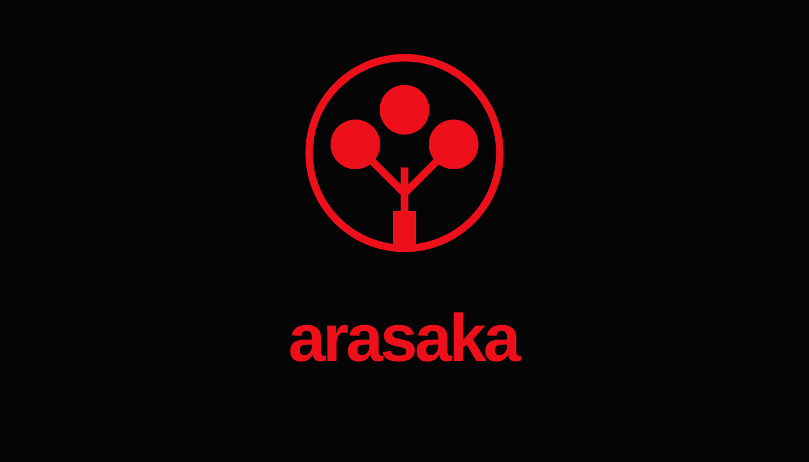

# Login-atividade

<p align="center">
  <strong>Uma atividade prática de desenvolvimento web com estética cyberpunk inspirada na Arasaka.</strong>
</p>

<p align="center">
  
</p>

## Sobre o projeto

Este projeto foi desenvolvido como exercício de HTML, CSS e JavaScript, com páginas de navegação e formulários de login e cadastro. A identidade visual usa um fundo escuro e elementos inspirados no universo cyberpunk, mantendo a imagem original do projeto.

## Páginas

- **Página inicial:** apresenta as opções de navegação.
- **Login:** interface para entrada de usuário.
- **Cadastro:** interface para criação de conta.

## Tecnologias utilizadas

- **HTML5** para estruturar as páginas.
- **CSS3** para cores, fundos, formulários, efeitos visuais e responsividade.
- **JavaScript** para os comportamentos programados nas páginas.

## Como executar

1. Faça o download do repositório ou clone-o:
   ```bash
   git clone https://github.com/machadodeassisll76blip/Login-atividade.git
   ```
2. Entre na pasta do projeto:
   ```bash
   cd Login-atividade
   ```
3. Abra o arquivo `index.html` no navegador. Você também pode abrir a pasta no VS Code e usar uma extensão de servidor local, como o Live Server.

> **Observação:** mantenha a pasta `img` junto dos arquivos HTML para que a imagem de fundo seja carregada corretamente.

## Objetivo de aprendizagem

Praticar a construção de páginas web, a organização de elementos HTML, a estilização com CSS e a implementação de interações com JavaScript.

---

<p align="center">
  Feito como projeto de estudo.
</p>
